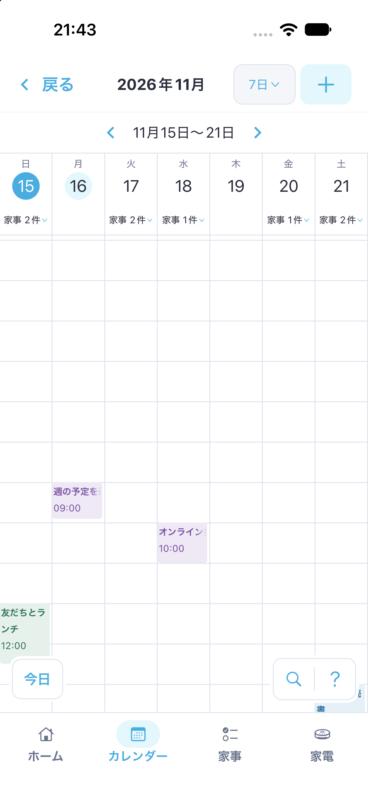
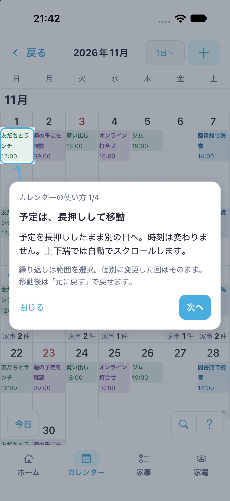
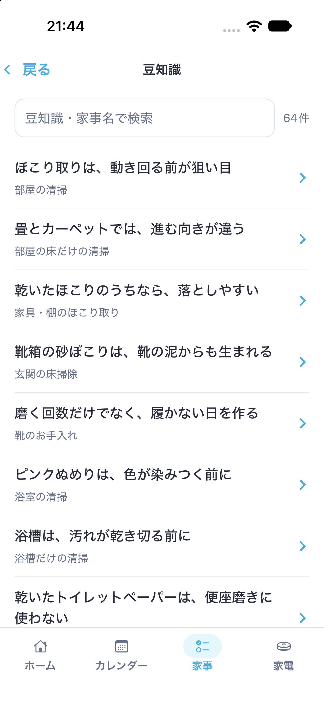

# LiFlow

**家事を「いつ・何を・どうやるか」考える負担を減らす、家事と予定の管理アプリ。**

家事を選んで生活リズムを設定すると、周期・負荷・休日・天気・予定の忙しさをもとに、実施する日を提案します。ホームで完了を記録すると、実際に行った日を次回の計画へ反映します。手順を調べたいときは家事一覧、家電のお手入れを調べたいときは説明書PDFから確認できます。

個人での利用に加えて、家族・同居人との家事共有にも対応しています。個人の家事・予定と、グループへ共有する情報は分けて保存します。

> iOS・Android向けに開発中です。ソースコードの正本はこのリポジトリの `main` です。配布・課金・本番の家電解析の進み具合は [現在の制約](#現在の制約) を参照してください。

- [画面と基本の使い方](#基本の使い方)
- [家事・カレンダー・家電・共有の機能](#機能)
- [端末に保存するデータと外部送信](#データと外部送信)
- [開発環境と動作確認](#開発構成)
- [実機や自動テストで確認したこと](#検査)

## 画面

2026年11月15日のコードを使ったiOSシミュレーター画面です。掲載用の予定・家事・家電は確認用データです。

<p align="center">
  
  
  
</p>

<p align="center">ホーム ／ カレンダー ／ 説明書PDFから家電を追加</p>

<p align="center">
  
  
  
</p>

<p align="center">家事一覧 ／ 家事の説明 ／ 初回設定</p>

<p align="center">
  
  
  
</p>

<p align="center">7日表示 ／ 実画面の操作案内 ／ 豆知識</p>

撮影時のビルド・データ・確認範囲は、[2026年11月15日の画面検査](docs/audits/2026-11-15-calendar-final-verification.md)と[画像の記録](docs/readme/screenshots.json)に記載しています。

## 起動時間

2026年11月19〜20日に、実機のReleaseビルドでアプリを完全終了した状態から計測しました。

| 端末・条件 | 起動後に確認した到達点 | 中央値 | 最も遅い確認 | 1.5秒以内 |
| --- | --- | ---: | ---: | ---: |
| iPhone 12・通常起動 | ホームの完了チェックとカレンダータブが操作可能 | 0.738秒 | 0.838秒 | 3/3回 |
| Android Xperia・通常起動 | 最初のタップで完了チェックが画面に反映 | 1.414秒 | 1.447秒 | 5/5回 |
| Android Xperia・上書き更新直後 | 最初のタップで完了チェックが画面に反映 | 1.489秒 | 1.505秒 | 4/5回 |

11月19日のAndroidの前後比較では、同じ計測方法で画面情報の取得まで含めた中央値が2.846秒から1.650秒へ約42％短縮しました。上書き更新直後の残り1回は、1.496秒時点で未表示、1.505秒時点で表示を確認しました。

計測ビルドのソースは各コミットで確認できます。[iOS b08138e](https://github.com/ponkichi1552/LiFlow/commit/b08138e9fe87b24a5e4b344f94694ff06af769d8)・[Android 7203720](https://github.com/ponkichi1552/LiFlow/commit/7203720b4f993343792013001e37158e2b331e8b)

## なぜ作るのか

家事には、作業そのもの以外にも判断が必要です。

- 何をする必要があるか。
- どのくらいの頻度で行えばよいか。
- 今日するか、休日に回すか。
- 洗濯を外に干せるか。
- 重い家事が同じ日に重なっていないか。
- 家電の説明書のどこに、お手入れ方法が書いてあるか。
- 終わった後、次にいつ行うか。

LiFlowは、予定を手動で並べるだけでなく、この判断を続ける負担を減らすことを目指しています。提案を使いながら、その日の予定や家事の実施日は自分で変更できます。

## 基本の使い方

### 1. 初回設定を終える

中心になる設定は「家事を選ぶ」「生活リズム」の2段階です。

1. 管理したい家事を選ぶ。
2. 休日、家事の頻度、使える時間と時間帯を選ぶ。
3. 「設定して始める」でホームへ進む。

時間や上限を最初から細かく入力しなくても、候補から選べます。1日の時間は15分・30分・60分・上限なし、時間帯は平日と休日に合った候補を用意しています。細かい時刻は後から設定で変更できます。

前回の実施日、天気予報の地域、ゴミ収集日は必要に応じて設定します。分からない日付を推測して入力する必要はありません。Google連携やグループ参加も、初回設定の必須条件ではありません。

### 2. ホームで今日の家事を確認する

- 推奨される家事と目安時間を確認する。
- 家事名を押して、手順や道具を読む。
- チェックで完了を記録する。
- 誤って完了した場合は、取り消して戻す。

家事の実施日、負荷、期限や担当などをもとに、表示順と提案を組み立てます。同じ家事の複数の候補がある場合にも、ホームで同じ日に重複して並ばないように扱います。

「今週の残り」は明日以降の家事です。ホームの家事名は説明を開く操作、完了チェックは実施を記録する操作です。カレンダーは日程確認・変更のための画面とし、完了チェックは置いていません。

### 3. カレンダーで日程を確認・調整する

予定・家事・ゴミ収集日を同じカレンダーで確認できます。予定は右上の「＋」から追加します。家事もカレンダーから選んで登録でき、設定画面を経由する必要はありません。初めて開いたときは、実際の画面と矢印で長押し移動などを案内します。右下の検索の隣にある「？」から、いつでも読み直せます。

### 4. 分からない家事は一覧で調べる

分類を開くか、名前で検索して、説明を開きます。「トイレ 清掃」のように複数の語でも探せます。作業の手順、使う道具、注意事項を確認できます。長い説明には右側の位置表示を用意し、前後の項目へ移動できます。豆知識は見出し・家事名・本文から検索でき、記事から戻ると検索語と一覧位置を保ちます。

### 5. 家電は取扱説明書PDFから追加する

「家電を追加」で取扱説明書PDFを選び、解析を開始します。メーカー・製品名・型番とお手入れ方法は同じ解析で読み取ります。結果を保存すると「掃除機」「洗濯機」などの種類から開けます。保存済みのお手入れを確認したり、実施周期を調整したりするときは、その家電を開きます。

### 生活の中での使い方

- **家事を溜め込みたくない日。** 使える時間と普段の休日を設定しておくと、目安時間や家事の重さを加味した候補がホームに出ます。終えた家事をチェックすると、実際の実施日が次回の計算に使われます。
- **家事の合間に予定を調整する日。** 月表示で日ごとの件数を見て、2日・3日表示で隣の日と比較できます。外出を追加したあと、必要な家事だけ日程を変えられます。時刻付きの外出と日付だけの家事を同じ画面で確認できます。
- **家族・同居人と分担する日。** グループに登録した家事を割り振り、手が空いている人が担当できる家事は「誰か1人」の方式で扱えます。本人の予定や家事と、グループで合意した分担をそれぞれ管理できます。
- **家電のお手入れを調べたい日。** 手元の説明書でフィルターの掃除手順や目安を確認し、登録した家電から後日読み直せます。メーカーが「汚れたとき」としている項目は、その条件を見ながら必要な日に実施できます。

## 機能

### 家事カタログと説明

- 81項目の説明を収録したカタログ。
- ゴミ収集を除く79項目を、個人・共有の家事選択に利用。
- 初回は基本の8家事を選択候補として用意。
- 分類別の一覧、家事名の検索、説明・手順・道具・注意事項。
- 自分で作る家事の追加と、名前や手順の編集。
- 個人とグループの家事を、保存先を区別して扱う画面。

「使用後」「必要なとき」など、日数周期を持たない作業を一律に「7日ごと」へ置き換えません。周期設定が必要ない家事は家事一覧から確認し、周期を設定する画面からは除きます。ゴミ出しも通常の完了回数や周期学習とは分けます。

カタログの採用仕様は[家事カタログ仕様](docs/specifications/housework-catalog-2026-11-04.md)を参照してください。

### 家事の予定計算

家事ごとの周期に加え、次の条件をもとに日ごとの負担を調整します。

| 条件 | 計画への反映 |
| --- | --- |
| 実際の実施日 | 完了した日を次回の基準や学習に反映 |
| 家事の負荷・目安時間 | 重い作業や所要時間の集中を抑える |
| 休日・実施可能時間帯 | 生活リズムに合わせて提案 |
| 1日の上限 | 設定した家事量や時間の範囲を考慮 |
| 天気予報 | 外干しなど天候の影響を受ける家事に反映 |
| Google Calendarの忙しさ | 忙しい時間や日の負担を調整 |
| 実施できる期間 | 推奨日を中心とした許容期間を扱う |

予定がある日をすべて家事禁止にする仕組みではありません。時刻のある予定の競合と、日単位での家事の負荷を分けて扱います。時刻未指定の家事を、勝手な開始・終了時刻で時間帯へ割り当てることもありません。

周期は「自動調整／固定」を選べます。「固定」を選ぶと、その時点で調整されている周期を保持します。毎月の日付や開始日、説明などは詳細設定で扱います。

予定の計算仕様は[適応する周期と配置](docs/specifications/adaptive-scheduling-2026-11-04.md)に記載しています。個人の提案と共有グループの正式な予定は別の計算・保存経路です。

### 実施履歴

個人の通常表示は実施した日時を中心にしています。グループでは日時に加え、必要に応じて当時の担当者・実際に行った人を確認できます。

画面を簡潔にしても、内部では取り消し、次回計算、共有時の整合性に必要な履歴を保持します。表示期間を絞ることと、保存済みの実施記録を削除することは別です。

### カレンダー

| 表示 | 主な用途・操作 |
| --- | --- |
| 年 | 月を探して移動。上下スクロールで前後の年を確認 |
| 月 | 日付ごとの予定・家事件数・収集日を俯瞰。上下スクロールで月を移動 |
| 1日 | 時間帯と家事を詳しく確認。左右スワイプで日を移動 |
| 2日 | 隣り合う日を比較。左右スワイプで1日ずつ移動 |
| 3日 | 予定名の表示幅を保って3日を比較。スワイプは1日ずつ、家事は件数を優先 |
| 7日 | 月と同じ7列を縦に広げ、時刻に対応する位置へ予定を表示。時刻は予定内に表示 |
| リスト | 予定と家事を日付順に確認 |

- 「今日」で、表示形式を保ったまま今日へ戻る。
- 年月から目的の月へ移動。
- 検索結果から、その予定・家事がある日付を表示。今日に近い順で、追加表示から全結果へ進める。
- 家事の件数を押して、その日の家事を開閉。
- カレンダーを離れた後は短時間なら表示を保持し、1分以上離れると月表示へ戻る。
- 表示形式などの一時的な状態を、アプリを完全終了した後まで保存し続けない。

月表示では週の高さをそろえ、表示領域に応じて予定を並べます。余った領域は長い予定名の2行表示や時刻の表示に使い、表示しきれない件数は「+2」のように別に示します。文字は不自然に縦横へ引き伸ばさず、末尾を薄くして省略します。

既存の表示メニューから、月の詳しさを「すっきり・標準・詳しく」で選べます。「詳しく」でもすべての週を同じ高さにし、家事・収集日・残り件数の領域を確保します。詳しさの設定はこの端末内だけに保存します。

Google由来の色にも対応し、ライトモードの白、ダークモードの黒など、背景に埋もれる色を調整します。

### 予定の登録・編集

- 個人／グループ共通の保存先を選択。
- 予定名、場所、メモ、開始・終了、終日、分類色を設定。
- 毎日・毎週・隔週・毎月・毎年・カスタムの繰り返し。
- 新規予定の名前から日時を設定。「毎週火曜日、日曜日ランチ」「毎月11日、12日ハッカソン」「毎年5月22日お父さん誕生日」は、指定された日と繰り返しを反映。手で選んだ設定を優先し、文章はそのまま保存。
- カスタム間隔、複数曜日、毎月の複数日付・第N曜日・最後の曜日などの指定。
- 変更範囲は「この予定だけ・今後の予定すべて・繰り返し全体」。編集とドラッグで同じ3択。
- この回だけの削除と、繰り返し全体の削除。
- 予定の複製。
- 予定ごとの事前通知。

「今後」は選んだ回以降を変更し、過去の回を保ちます。今後・全体を変更しても、個別に変更した回を自動でリセットしません。ドラッグ直後の「元に戻す」は、今後のシリーズを分けた変更にも対応し、その後の別の編集を上書きしません。

新規の予定名には「来週の火曜日18時から友達と食事」「2週間後11時」「来月10日」などの日時を含められます。AIやネットワークを使わず、対応する表現を規則で認識して日時へ反映します。予定名はそのまま残し、手で変更した日時を優先します。「来週」は月曜始まり、年を省略した月日は今日以降で次に来る日付です。明記された過去年は維持し、2月29日は実在する年を選びます。既存予定の編集・複製・誕生日・家事のフォームは自動入力の対象外です。

「旅行 4月11日から1週間」は4月11〜17日、「1月1日から親戚との集まり6日間」は1月1〜6日の終日予定になります。時刻が明記された期間は、その開始時刻から同じ時刻までの日数として扱います。「11時頃」「4月11日頃」「約1週間」などは、書かれた数値を修正可能な候補として入力します。「ランチ」だけから12時を補わず、存在しない日や否定・代替候補・未対応の範囲を一部だけ採用しません。

表示メニューの「予定名の日時表現を省略」は初期オンです。「毎月21日学校」は「学校」、「毎週火曜日、日曜日ランチ」は「ランチ」と表示し、編集・保存・検索には原文を保持します。オフなら原文を表示します。省略後に名前がなくなる場合は原文を表示します。

省略オンでは、Googleへ送る予定名も省略します。LiFlowに保持している原文を、Googleからの自己送信分の戻りや他欄だけの編集で失わないよう照合します。Googleで名前が明示的に変更された場合はその変更を採用します。設定の切り替えだけで保存済みGoogle予定を一括再送せず、次の新規登録・内容変更から送信名へ適用します。設定は端末内に保存し、Google Tasksの家事名や連携権限は変えません。

入力中の保存先を切り替えた際には、入力内容を引き継ぎます。一方、保存されていない内容を破棄して閉じた後に、次の新規入力へ勝手に戻すことはしません。閉じる際の確認と、保存する操作は区別します。

### カレンダーから家事を追加

個人・グループの両方で、既存の家事を選ぶ方法と、新しく作る方法を用意しています。

1. 日付を選び、「＋」から家事を選ぶ。
2. 元の追加画面で開始・終了の日付を決める。
3. 必要なら時刻や詳細設定を変更し、保存する。

選んだ日1回の登録が基本です。繰り返す場合だけ周期や選択日の設定を表示します。共有家事の担当など、追加の項目は詳細設定にまとめます。

家事の時刻は任意です。未指定欄は `--:--` と表示し、開始・終了時刻を勝手に入力しません。日付だけでも登録できます。選択した家事は解除・選び直しができ、同じ予定回の二重登録を防ぎます。

### ドラッグによる予定移動

- 短い長押しの後に、予定をドラッグして移動。
- 1日・2日表示では日付と時刻を変更。
- 月表示では時刻を保ったまま日付だけ変更。
- 月表示で上下端へ持っていくと、自動スクロールして見えていない日へ移動。
- 移動後は控えめな「元に戻す」から取り消し。
- 繰り返しは「この予定だけ・今後の予定すべて・繰り返し全体」から移動の対象を選択。

全体を移動するときも個別変更済みの回は保持します。ドラッグで権限や競合確認を迂回することはありません。

### 日本の祝日・誕生日

日本の祝日をアプリ内で表示します。月表示では日付の色で示し、予定名の領域を使いません。1日・2日・リスト表示では祝日名も表示します。内蔵の祝日をGoogle Calendarへ予定として書き出すことはありません。

本人の誕生日は設定の「一般」から登録できます。当日のホームに「お誕生日おめでとう！」を表示し、カレンダーの日付にはプレゼントの印を使います。年齢の公開や、グループメンバーへの自動共有のための機能ではありません。

### ゴミ収集日

- 種類ごとに毎週・隔週・毎月の収集日を登録。
- 毎週の収集は曜日、隔週・毎月の収集は日付にも表示。
- 種類名とマークで区別。
- 特定の収集予定を非表示にし、後から再表示。
- 非表示にしても、収集ルール自体は維持。

自治体ごとの祝日変更や臨時収集を、自動で取得する機能ではありません。自治体の案内を確認して対象日を調整します。

### 天気に合わせた家事

「天気予報・洗濯」の設定で地域を選ぶと、外干しなど天候に左右される家事の提案に予報を使います。予報を取得できない場合も、端末にある有効な予報や通常の家事計画で画面を開けます。

現在の構成では、アプリが設定されたRaspberry Piの天気APIへHTTPSで接続し、PiがMET Norwayの予報を地域単位でキャッシュします。同じ版なら `ETag` で確認して本文を省きます。家事を行う日や負荷の計算は端末内で行います。[天気APIと通信削減の検査](docs/audits/2026-11-20-server-minimization.md)

### Googleとの連携

「設定 → アカウント・連携」からGoogleアカウントと接続し、利用する機能をオン／オフにします。機能ごとに最初から4回ログインする前提の操作にはしていません。Google側で追加の認証や権限が必要な場合には再認証が必要です。

アカウントの変更、接続解除、ログアウト、再接続に対応します。ログアウトと端末内の家事・予定を削除する操作は別です。

| 連携 | 内容・境界 |
| --- | --- |
| 個人のGoogle Calendar | アクセスできる予定を本人の画面へ取り込み、編集可能な個人予定を双方向で同期 |
| 空き時間の参照 | 予定の時間帯や忙しさを、本人の家事提案や競合確認に利用 |
| 共有予定をGoogleへ表示 | LiFlowの共有予定を自分のGoogle Calendarへ表示。Google側の変更はグループへ反映しない |
| 個人のGoogle Tasks | 家事名・予定日を同期し、完了・取り消しを相互に反映 |
| 共有家事のGoogle Tasks | 自分のGoogle Tasksへ共有家事を同期。共有の業務権限に従って完了・取り消しを扱う |

Googleの共有カレンダーを読み込んでも、その内容をLiFlowの他のメンバーへ自動公開しません。本人専用の予定、空き時間の共有、グループ共通の予定を分けて扱います。

Google Tasksは予定を毎回削除・再作成せず、対応するIDを保持して更新します。起動・復帰・手動同期・実行可能なバックグラウンド処理で差分を処理します。Google側の認証切れや通信断は、未接続・再認証・再試行が必要な状態として表示します。

無変更のまま10分ごとに同期するタイマーは使いません。端末内の変更、遠隔の変更通知、起動・復帰、手動更新を契機にし、失敗・未完了の処理だけを再試行します。OSがバックグラウンド処理を起動しても、正常に同期済みのデータを毎回取り直しません。Google側だけで変更した予定は、次の起動・復帰・手動更新などで確認します。

設定方法は[Google連携のセットアップ](docs/google-sync-setup.md)、今回までの変更は[再接続](docs/google-sync-reconnect-2026-11-12.md)、[一度の接続と切り替え](docs/google-unified-connection-2026-11-12.md)、[既存端末のTasks更新](docs/google-tasks-existing-device-upgrade-2026-11-12.md)を参照してください。

### 家電の説明書PDFとAI解析

ユーザーが添付した説明書を入力にし、次の情報を同じ解析で取得します。

- メーカー、製品名、型番、家電の種類。
- お手入れ項目、手順、道具、注意事項。
- 説明書に明記されている周期・条件。

入力はパスワードのないPDFで、上限は6MiB・100ページです。メーカー・製品名・型番を先に入力させたり、別の検索で説明書を選び直させたりする流れにはしていません。

読み取れる機種情報を使って解析し、説明書に型番の記載がない場合は空欄として扱います。記載が確認できれば、添付したPDFのページ番号を示します。製品ページと説明書で型番の表記が異なる場合も、添付資料に記載された内容が確認の基準です。

受付後にカレンダーなどへ移動でき、家電に戻ると解析の行から進捗や結果を開けます。受け取ったPDFと結果を端末に保存してから、サーバーへ受領を伝えます。保存済みの説明は家電一覧から読めます。

登録したPDFは後からアプリで開けます。保存済みのPDFを読む操作で、再解析を実行したり解析回数を増やしたりしません。長いお手入れ説明は項目ごとの文書として読み、位置表示から移動できます。

**周期をAIに推測させないことを重視しています。** 「汚れたとき」「使用後」「MAXラインに達したら」などの条件を、根拠のない日数へ変換しません。メーカーが具体的な周期を示していない項目は定期予定へ自動登録せず、必要なときに説明を確認できます。

個人側の登録では確認できた結果を保存し、共有側では送信先と解析結果を確認した上で共有します。既に編集した家事の手順・設定を、再解析結果で無断で置き換えません。PDFと解析結果を共有するときは、その共有先も画面に示します。

詳細は[PDFのみの登録への変更](docs/appliance-pdf-only-2026-11-13.md)、[家電の種類を中心とした一覧](docs/appliance-index-kind-2026-11-13.md)を参照してください。

### 共有グループ

所属できるグループは1つです。家族／同居人を選び、招待・参加申請・承認を経て利用します。

- 個人の家事・予定を、グループへ自動でコピーしない。
- 共有する家事を選び、担当・周期・実施日を設定。
- 誰か1人、各自、担当者の指定、交代などの担当方式。
- 当時の担当者と実施者を区別した記録。
- 日時変更の申請・承認、担当変更、権限に応じた操作。
- オフラインで保存し、接続後に送信待ちを再処理。
- 同時編集は競合として確認し、見ていない変更を上書きしない。
- メンバーの除名、鍵更新、所有者の引き継ぎ、承認端末の管理。
- 必要な場合に所有者が確認する復旧操作。

共有の業務データは端末で暗号化し、署名付きの操作として送受信します。通信が途切れたときは端末で送信待ちを保持し、接続後に続きから同期します。受信側では署名と権限を検証して保存し、同じ操作を再受信しても一度だけ適用します。

一時配送方式を有効にしたグループでは、次の流れでサーバー側のコピーを整理します。

1. 変更を端末に保存し、暗号化・署名した差分をFirestoreへ配送します。
2. 受信端末は内容を検証し、SQLiteへ保存を確定したあとで、保存位置に対応する受領署名を返します。
3. 全承認端末の受領が確認できた本文、または24時間の期限を過ぎた本文をワーカーが削除します。参加・承認の状態、公開鍵、保存位置、署名の検査に必要な記録は保持します。
4. 復旧が必要になった端末は、最新データを持つ別の承認端末から受け取ります。復旧に使えるコピーを持つ端末が少なくとも1台必要です。

一時配送はビルドの既定ではオフです。個別のグループで、対応Rules・ワーカー・承認端末の保存後の署名を確認してから有効化します。2026年11月23日には、iPhoneとAndroidの2台を承認した新グループで、保存後の署名がそろってから本番の自動削除を有効にし、サーバー本文の消去と端末間の復旧まで確認しました。[署名付き受領の設計](docs/security/signed-device-delivery.md)・[通信と保存の最小化・配備条件](docs/security/data-minimization-2026-11-15.md)

同じアカウントの別端末へ、本人用の生活リズムや空き時間を同期する経路は、グループ共有とは分けています。他メンバーへ本人の設定や予定本文を渡すための機能ではありません。

設計は[共有グループ設計](docs/shared-groups-design.md)、[v2仕様](docs/sharing-v2/01-specification.md)、[進捗と検証範囲](docs/sharing-v2/05-progress.md)を参照してください。

#### 新しいグループへ引き継ぐ

共有グループの管理画面に「新しいグループへ引き継ぐ」が表示されたときは、同期済みの家事・共有予定・設定を新しいグループにコピーできます。元のグループと、過去の実施・取り消しに使われた元の署名を保持します。引き継ぐメンバーは各自のアカウントで新グループへの参加と端末の承認を済ませます。新しいグループの一時配送を有効にする場合も、承認済みの端末がデータを保存してから受領を確認します。

### 通知とウィジェット

- 家事通知とカレンダー通知を別々にオン／オフ。個人家事は通知時刻を変更でき、初期値は9:00です。共有グループごとの本人用時刻は独立しています。
- 予定ごとに「通知なし・開始時・10分前・1時間前・前日」を選択。
- OSで通知が許可されていない場合に設定へ進む導線。
- 個人の今日の家事を最大3件表示し、完了を記録するウィジェット。
- 共有メンバーの完了を受信したときの通知は初期OFFの選択機能。

OSの通知許可、ウィジェットの追加、バックグラウンド実行の判断は端末側の条件に依存します。バックグラウンド同期の時刻や、常時の即時反映は保証しません。

### 表示と操作の方針

- 初めて見た人が押せる場所と操作結果を理解できること。
- 追加・編集・検索を、元の画面との関係が分かる導線にすること。
- 保存先や有効状態を、色だけに依存せず示すこと。
- 長い家事名、入力キーボード、画面下部のバーで内容を隠さないこと。
- プレースホルダーと入力済みの文字を見分けられること。
- ライト／ダークに対応し、設定から外観も選べること。
- 一時的な表示の展開と、ユーザーが保存した設定を区別すること。

見た目を固定値だけで検査せず、保存・権限・操作の検査と、実画面での確認を分けます。[UIルール](docs/ui-design-rules.md)と[テスト方針](docs/testing-strategy.md)にまとめています。

## データと外部送信

| 情報 | 主な保存先・外部送信 |
| --- | --- |
| 個人の家事・履歴・設定・ローカル予定 | 端末内のExpo SQLite |
| Google連携を有効にした情報 | 本人が接続したGoogle Tasks／Calendar |
| 天気の取得 | 設定した地域の予報をRaspberry Piの天気APIから取得。PiがMET Norwayへ照会し、予報をキャッシュ |
| 家電AIの入力 | 解析を実行したときに、選択したPDFを端末で検査・暗号化して公開用APIへ送る構成。解析ワーカーが復号してOpenAIへ渡す |
| 解析の一時データ・結果 | 解析確定後に入力を削除。結果は端末の保存後に返る受領確認、または取得期限後の清掃で削除 |
| 保存した家電情報・PDF | 端末内。明示的に共有するものはグループにも保存 |
| 共有家事・予定・履歴など | 端末の共有用SQLite。暗号化・署名した差分をFirestoreへ配送し、設定された対象では本文を期限付きで保管 |
| 本人端末間の設定・空き時間 | 本人の承認端末向けに別の鍵とデータ経路で同期。共有グループに参加している他の人への配送は発生しない |
| 認証・端末・購入の検証 | 各サービスと必要な検証API |

基本の家事管理・履歴・予定計算は端末内で動作します。オフラインでも保存済みの家事・予定・PDFを開けます。共有の送信待ちやGoogle連携の再試行は、対象のアカウントと接続先に結び付けます。OpenAI APIキーはサーバーの解析ワーカーで管理します。

AI結果の受領確認は、本人認証・結果のハッシュ・受領トークンで検証します。応答が切れた場合は同じ受付IDから状況を確認します。未受領結果の取得期限は24時間で、期限後は清掃処理が実体を削除します。OpenAIなどの外部提供元、Firestoreのバックアップ、運用ログにはそれぞれの保持ポリシーが適用されます。[解析の入力・受領と保持](docs/appliance-public-api-2026-10-31.md)

## 現在の制約

### 配布・外部サービスの準備状況

2026年11月23日時点の開発・検証状況です。

| 項目 | 確認したこと | 次に必要なこと |
| --- | --- | --- |
| iOS | 開発署名で実機に導入。App Store Connectにアプリを登録 | 有料アプリ契約の有効化確認、ストア商品・購入検証の設定、TestFlightでの確認 |
| Android | 開発署名で実機に導入。Play Integrity APIを有効化し、ハードウェア鍵のサーバー検証を実機で確認 | Play Consoleのアプリ登録・連携、Device Recall、ストア商品とテスト配布の準備 |
| 家電AI | Raspberry PiでHTTPSとサーバー構成を用意し、検証用PDFを実APIで解析。別の隔離環境ではiPhoneからの受付、結果の保存、再表示を確認 | 端末証明と利用権がそろい次第、本番APIとワーカーを稼働。iPhone・AndroidでPDF選択から結果受領まで通す |
| 共有と本人同期 | 両OSで保存後の受領署名と別端末からの復旧を確認。新グループへ署名付きの実施履歴を引き継げる | 一時配送を有効にする対象ごとに、対応ビルドと全承認端末の受領署名を確認 |

家電AIの公開構成では、アカウントと検証済み端末の両方に月5回の枠を持たせ、残りの少ない方を適用します。枠は毎月1日9:00（日本時間）に切り替わり、再解析も1回に含めます。同じ端末でのアカウント切替には端末側の使用数が引き継がれます。再インストール後に当月の端末登録だけが確認でき、以前の端末鍵を確認できない場合は、翌月の切替まで新規解析を保留します。保存済み家電の説明は開けます。[家電AIの公開API](docs/appliance-public-api-2026-10-31.md)・[契約・購入の実装記録](docs/subscription-implementation-2026-11-02.md)

### 同期・端末ごとの条件

- Google連携にはOAuth設定を含むdevelopment buildが必要です。
- 通信断・権限失効・Google側の制限により、再認証や手動同期が必要になる場合があります。
- OSがバックグラウンド処理をいつ実行するかはアプリから保証できません。
- 機種・OS固有の通知、ウィジェット、認証をシミュレーターだけで保証しません。
- 独立した外部セキュリティ監査は未完了です。

### 対応範囲

- 内蔵祝日は日本向けです。
- 自治体ごとの臨時収集変更を自動で追跡しません。
- 家電の手入れ方法が記載された、パスワードなし・6 MiB以下・100ページ以内のPDFに対応します。機種情報は説明書から確認できる範囲を使います。
- メーカーが示していない周期を、AIで補って定期予定にすることはしません。

## 開発構成

### 主な技術

| 領域 | 技術 |
| --- | --- |
| アプリ | Expo SDK 58、React 19.3、React Native 0.88.1、TypeScript |
| 画面とナビゲーション | Expo Router、React Native、Reanimated、Gesture Handler |
| 端末内の保存 | Expo SQLite。アカウント・端末ごとに必要な鍵の保存にはOSの安全な領域を利用 |
| 日時 | ローカル日付のドメインモデル、moment-timezoneのタイムゾーン情報 |
| Google | ネイティブGoogle認証、Google Tasks API、Google Calendar API |
| 共有 | Firebase Auth、Firestore、端末での暗号化とEd25519署名。対応するネイティブ環境ではlibsodiumで署名を検証 |
| 通知・背景処理・ウィジェット | Expo Notifications、BackgroundTask、Widgetsとネイティブ連携 |
| 天気 | Raspberry Pi上のNode.js・SQLite、MET Norwayの予報、アプリからのHTTPS接続 |
| 説明書解析 | 端末でのPDF検査と暗号化、Node.jsの受付APIと解析ワーカー、OpenAI Responses API |
| 検査 | Node test runner、SQLite、画面ハーネス、Firebase Emulator、ネイティブ検査、GitHub Actions |

SDKの対応バージョンは `package.json` とロックファイルが基準です。Expoの最新SDKへ、検査なしに読み替えないでください。

### ディレクトリ

```text
src/
  app/                         Expo Routerの画面・ルート
  components/                  共通の表示・入力・操作部品
  domain/                      家事、日付、予定計算などの純粋なルール
  features/
    onboarding/                初回設定
    chores/                    家事一覧・説明・個人家事追加
    planner/                   提案と表示の組み立て
    calendar/                  カレンダー、編集、検索、通知、ドラッグ
    google-sync/               Google連携の調整・差分処理
    appliance-care/            PDF登録・解析・お手入れ説明
    settings/                  生活リズム・家事・連携などの設定
    sharing/                   共有、暗号、競合、権限、本人端末間同期
  platform/                    DB、認証、API、OS固有の実装
server/
  appliance-care-api/          PDF解析・利用制限・公開API
  account-device-api/          アカウント・端末確認
plugins/                       Expo config plugins
modules/                       端末証明・署名検証などの自前ネイティブモジュール
scripts/                       契約・依存・ビルドの検査とSDK補正
tests/                         単体・画面操作・Cloud・ネイティブの回帰検査
docs/                          仕様、設計、検査記録、画面画像
tools/                         開発時の確認用ツール
```

画面内へ保存や同期を直接詰め込まず、ドメインのルール、機能、端末・外部サービスとの境界を分けています。共有はローカル保存と送信待ちを同じ更新に含め、保存済みの操作を再送しても重複適用しないように扱います。

| 実行場所 | 主な処理 |
| --- | --- |
| アプリ | 家事計画の計算、予定年・月・週の表示、通知登録、オフライン保存、Googleとの本人アカウントの同期、共有データの暗号化と検証 |
| 共有サービス | 本人・所属の確認、暗号化された変更の配送、受領・削除の管理、本人の承認端末への復元 |
| 天気サービス | 地域ごとの予報の取得と再利用。端末が同じ版を持つときは本文の転送を省く |
| 家電の受付API・解析ワーカー | 本人・端末・利用権・回数の確認、暗号化PDFの一時受付、ワーカーでのPDF検査と解析、端末受領後の結果削除 |

### 開発環境の準備

Node.js 24とnpmを使います。リポジトリを取得したら、ルートで依存関係をインストールします。

```bash
npm ci
```

環境変数の項目は [`.env.example`](.env.example)、サーバー用は [`.env.server.example`](.env.server.example)を参照してください。秘密情報をコミットしないでください。外部サービスを設定しなくても、個人の家事管理のコードを確認できます。

| 使いたい機能 | 準備するもの |
| --- | --- |
| 個人の家事・カレンダー | Node.js 24、npm、iOSはXcode、AndroidはAndroid SDKを含むネイティブ開発環境 |
| Google Calendar・Tasks | GoogleのOAuthクライアントと、対象機能に使うAPIの有効化。 [Google連携のセットアップ](docs/google-sync-setup.md) |
| 共有・本人の端末間同期 | テスト用FirebaseプロジェクトまたはEmulator、対応するAuth・Firestore設定。 [共有v2の仕様](docs/sharing-v2/01-specification.md) |
| 天気・洗濯の提案 | `EXPO_PUBLIC_WEATHER_SELF_HOST_URL` に設定する天気API。ローカル証明書を使用する開発環境では `EXPO_PUBLIC_WEATHER_SELF_HOST_TLS_CERT` を利用できます。 [天気の開発・配備記録](docs/audits/2026-11-20-server-minimization.md) |
| 説明書の解析 | `.env.server` にサーバー側のOpenAI設定。公開用構成ではHTTPSの接続先、アップロード公開鍵、ストアと端末証明の設定。 [公開APIの構成](docs/appliance-public-api-2026-10-31.md) |

### アプリの起動

ネイティブ認証・ウィジェット・保存などを含むため、最終確認にはdevelopment buildを使います。Expo Goだけを、その代わりの検証環境にはしません。

```bash
# iOSのdevelopment build
npm run ios

# Androidのdevelopment build
npm run android

# development buildを作成した後の開発サーバー
npm start
```

クラウドビルドにはEASを利用できます。ネイティブ設定は `app.json`・config pluginsなどを基準に生成し、生成されたプロジェクトだけを手修正して正本にしないでください。

Expo SDK 58の情報は[バージョン別ドキュメント](https://docs.expo.dev/versions/v58.0.0/)、ルート構成は[Expo Router](https://docs.expo.dev/router/introduction/)、クラウドビルドは[EAS](https://docs.expo.dev/eas/)を参照してください。

### 確認用データを開く

`EXPO_PUBLIC_LIFLOW_UI_REVIEW=menu` を設定した開発版では「設定 → UI確認用データ」から、合成データを使った画面を開けます。複数日にまたがる予定、長い予定名、共有家事、家電の解析中・結果・エラーなどを、実際に操作して確認できます。ケースを開き直すと、そのケースの初期状態に戻ります。`EXPO_PUBLIC_LIFLOW_UI_REVIEW=1` は起動時から確認画面を表示する撮影・検査用です。[画面検査の運用](docs/testing-strategy.md)

### 家電AIの開発API

```bash
npm run api:install
npm run api:dev
```

開発APIと公開APIは入口・認証条件を分けています。公開側の未設定の認証・端末証明を、開発用の認証へ自動で置き換えることはしません。APIキーはサーバー側だけへ設定し、クライアントの `EXPO_PUBLIC_` 変数へ入れないでください。

開発APIの設定例は `OPENAI_MODEL=gpt-6-luna` と `OPENAI_REASONING_EFFORT=max` です。モデルと推論量はサーバー設定から読み込みます。公開環境では、端末に渡すアップロード公開鍵とワーカーが持つ復号鍵、端末証明、購入検証、配信先の設定をそろえてから受付を開始します。[家電APIの設定例](.env.server.example)・[公開受付の前提](docs/appliance-public-api-2026-10-31.md)

## 検査

### 実機・サービスで確認したこと

| 対象 | 確認したこと |
| --- | --- |
| Google Calendar・Tasks | Googleアカウントを切り替えて旧アカウントの共有処理が引き継がれないこと、Tasksを解除したあともCalendarが動作することを、iPhoneとAndroidで確認 |
| 共有・本人同期 | 隔離環境で両実機の署名を照合。期限後にサーバーの本文が消えた状態から、承認済み端末間の復旧と再起動後の保存を確認 |
| 新しい共有グループへの移行 | 11月23日の開発版で、元の署名付き実施・取消の履歴を両実機で照合。承認2台の受領後に本番の削除を確認し、残った端末のコピーからAndroidの空の検証領域へ復旧 |
| 家電解析 | iPhoneの隔離検証版で型番のないPDFを実際に解析し、カレンダーへ移動してから家電へ戻り、お手入れ結果を開いて端末へ保存できることを確認 |
| 天気 | 実機からRaspberry Piの天気APIへの接続、予報のSQLite保存と、同じ版に対して本文のない応答が返ることを確認 |

以前のビルドの件数・端末・試験条件は日付付きの記録で確認できます。[全体検査](docs/audits/2026-11-15-full-check-and-readme.md)・[初回共有受信](docs/audits/2026-11-16-initial-group-sync.md)・[実機の表示と接続状態](docs/audits/2026-11-16-physical-calendar-followups.md)・[サーバーと天気API](docs/audits/2026-11-20-server-minimization.md)

[216項目の実機検証候補](docs/physical-device-validation-2026-11-15.md)には、端末、アカウント、外部変更、復元、通知、通信や性能の条件をまとめています。結果を確認するときは各試験の実施状況を参照してください。

### 普段の検査

```bash
npm run lint
npm run typecheck
npm test

# まとめて実行
npm run check
```

`npm test` の前処理で、機能契約に登録された回帰テストの存在と、共有Schedulerの版・ソース・タイムゾーンの整合性を検査します。必要なテストを外したまま成功させるためのスキップ設定は置きません。

OS固有の分岐は、次の指定でも実行します。

```bash
HOUSEWORK_TEST_PLATFORM=ios npm test
HOUSEWORK_TEST_PLATFORM=android npm test
```

保存・取り消し・連打・通信断・再起動・遅延応答・競合・権限変更・個人／共有の境界などを回帰対象にしています。画面テストも、単に文字列が存在するかではなく、どの対象へ操作が届き、何が保存されたかを確認します。

### Cloud結合検査

Auth／Firestore Emulatorを使い、本番とは分離した検査用プロジェクトで実行します。Firestore EmulatorにはJava 21以上を使います。

```bash
npx --yes firebase-tools@15.34.1 emulators:exec \
  --non-interactive --only firestore,auth \
  --project demo-liflow-sharing \
  "npm run test:sharing-cloud"
```

既に動いているエミュレーターと同時実行する場合は、ポートと設定を分けます。本番の共有グループや本番Rulesへ書き込んで結合検査を行うコマンドではありません。

### ネイティブ・依存関係・CI

- Expo SDKのロック済み依存関係との整合性。
- Androidの生成設定、セキュリティ境界、Kotlinのコンパイル。
- iOSウィジェットのプロセス間入力ジャーナル。
- アプリ、家電API、端末確認APIそれぞれの依存関係監査。
- GitHub ActionsのiOS／Android分岐とCloud結合検査。
- シミュレーターでの実描画、入力、遷移、スクロール、保存の確認。

自動テストの成功で、全端末の見た目・ジェスチャー・通知・実Google認証・実購入・実AI解析まで確認済みとはしません。実行した対象・ビルド・件数・残る制約は、[2026年11月15日の全体検査記録](docs/audits/2026-11-15-full-check-and-readme.md)へ分けて記録します。

以前の実機検査・本番サービス検査については、[実機間の共有検査](docs/shared-native-interoperability-2026-10-27.md)、[カレンダー検査](docs/calendar-native-2026-10-31.md)、[共有v2の検査記録](docs/sharing-v2/05-progress.md)を参照してください。日付の古い記録はその当時の結果です。

## 今後確認・改善すること

- 公開用の家電解析を、正規アプリの端末証明・購入検証と接続する。両OSの実機で実PDFの受付・保存・受領、アカウント切替と再インストール後の利用枠を確認する。
- 通知・背景同期・ウィジェットの実機とOSごとの継続確認。
- 小さな画面・文字拡大・明暗両モードでの操作確認。
- 初回設定から日常利用までの、初めて使う人による検証。
- ストアのテスト配布と実購入・復元の検査、公開前の外部セキュリティ監査。

## 関連資料

- [開発とブランチの運用](docs/development-workflow.md)
- [UIの設計ルール](docs/ui-design-rules.md)
- [テスト方針](docs/testing-strategy.md)
- [機能契約の登録](docs/feature-contracts.json)
- [Google連携の設定](docs/google-sync-setup.md)
- [家事カタログ仕様](docs/specifications/housework-catalog-2026-11-04.md)
- [周期と提案の仕様](docs/specifications/adaptive-scheduling-2026-11-04.md)
- [共有グループ設計](docs/shared-groups-design.md)
- [署名付きの受領と一時配送](docs/security/signed-device-delivery.md)
- [サーバー処理と通信の最小化](docs/audits/2026-11-20-server-minimization.md)
- [家電AIの公開API](docs/appliance-public-api-2026-10-31.md)
- [契約・購入の実装記録](docs/subscription-implementation-2026-11-02.md)

以前のデモ動画は[YouTube](https://youtu.be/RIMiwtUhU-I)にあります。以前のUIを使った動画であり、このREADMEの最新スクリーンショットとは表示・操作が異なる部分があります。

## ライセンス

[MIT License](LICENSE)。アプリへ取り込む説明書、外部サービス、依存ライブラリなどの利用条件は、それぞれの権利・規約にも従います。
