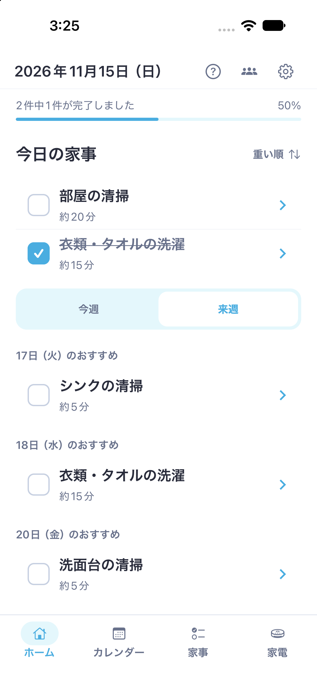
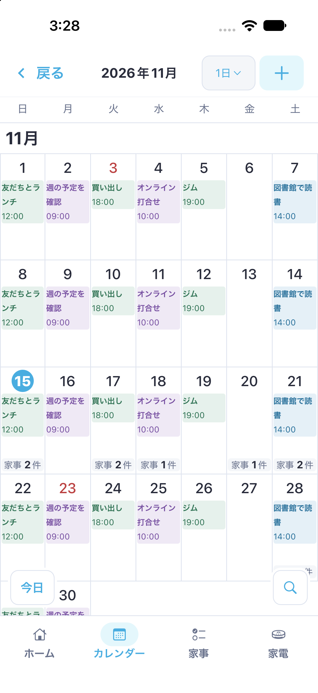
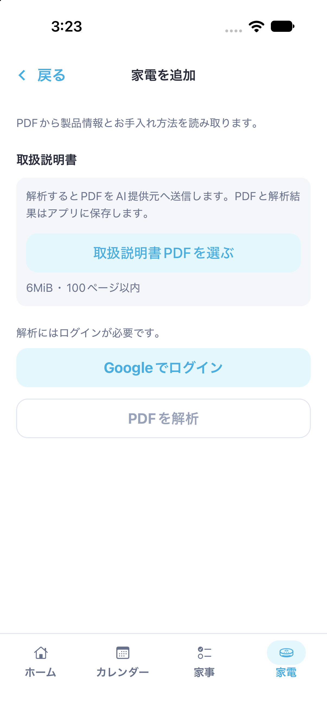
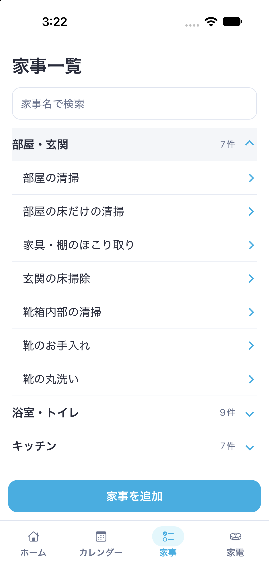
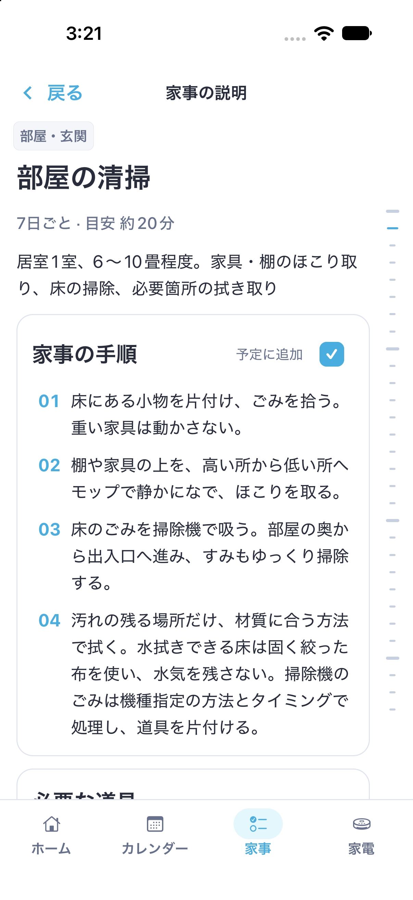
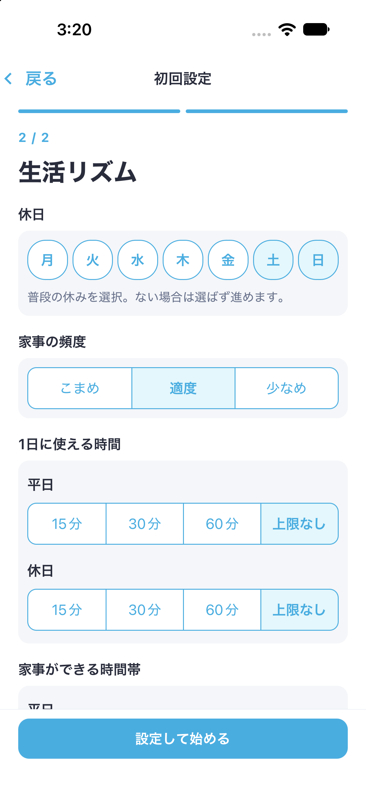

# LiFlow

**家事を「いつ・何を・どうやるか」考える負担を減らす、家事と予定の管理アプリ。**

家事を選んで生活リズムを設定すると、周期・負荷・休日・天気・予定の忙しさをもとに、実施する日を提案します。ホームで完了を記録すると、実際に行った日を次回の計画へ反映します。手順を調べたいときは家事一覧、家電のお手入れを調べたいときは説明書PDFから確認できます。

個人での利用に加えて、家族・同居人との家事共有にも対応しています。個人の家事・予定と、グループへ共有する情報は分けて保存します。

> 開発中のアプリです。コードの正本はこのリポジトリの `main` です。ストアでの一般公開、実購入、本番の家電AI受付が完了したという意味ではありません。実装済みの機能と外部サービスの準備状況は、後述の「現在の制約」で区別しています。

## 画面

2026年11月15日のコードを使ったiOSシミュレーター画面です。掲載用の予定・家事・家電は確認用データです。

<p align="center">
  
  
  
</p>

<p align="center">ホーム ／ カレンダー ／ 説明書PDFから家電を追加</p>

<p align="center">
  
  
  
</p>

<p align="center">家事一覧 ／ 家事の説明 ／ 初回設定</p>

掲載画像のビルドと確認範囲は、[今回の全体検査記録](docs/audits/2026-11-15-full-check-and-readme.md)に記録します。家電AIの画面掲載は、今回実際にOpenAI APIへ送信・解析したことを示すものではありません。

## なぜ作るのか

家事には、作業そのもの以外にも判断が必要です。

- 何をする必要があるか。
- どのくらいの頻度で行えばよいか。
- 今日するか、休日に回すか。
- 洗濯を外に干せるか。
- 重い家事が同じ日に重なっていないか。
- 家電の説明書のどこに、お手入れ方法が書いてあるか。
- 終わった後、次にいつ行うか。

LiFlowは、予定を手動で並べるだけでなく、この判断を続ける負担を減らすことを目指しています。提案を使いながら、その日の予定や家事の実施日は自分で変更できます。

## 基本の使い方

### 1. 初回設定を終える

中心になる設定は「家事を選ぶ」「生活リズム」の2段階です。

1. 管理したい家事を選ぶ。
2. 休日、家事の頻度、使える時間と時間帯を選ぶ。
3. 「設定して始める」でホームへ進む。

時間や上限を最初から細かく入力しなくても、候補から選べます。1日の時間は15分・30分・60分・上限なし、時間帯は平日と休日に合った候補を用意しています。細かい時刻は後から設定で変更できます。

前回の実施日、天気予報の地域、ゴミ収集日は必要に応じて設定します。分からない日付を推測して入力する必要はありません。Google連携やグループ参加も、初回設定の必須条件ではありません。

### 2. ホームで今日の家事を確認する

- 推奨される家事と目安時間を確認する。
- 家事名を押して、手順や道具を読む。
- チェックで完了を記録する。
- 誤って完了した場合は、取り消して戻す。

家事の実施日、負荷、期限や担当などをもとに、表示順と提案を組み立てます。同じ家事の複数の候補がある場合にも、ホームで同じ日に重複して並ばないように扱います。

ホームの家事名は説明を開く操作、完了チェックは実施を記録する操作です。カレンダーは日程確認・変更のための画面とし、完了チェックは置いていません。

### 3. カレンダーで日程を確認・調整する

予定・家事・ゴミ収集日を同じカレンダーで確認できます。予定は右上の「＋」から追加します。家事もカレンダーから選んで登録でき、設定画面を経由する必要はありません。

### 4. 分からない家事は一覧で調べる

分類を開くか、名前で検索して、説明を開きます。作業の手順、使う道具、注意事項を確認できます。長い説明には右側の位置表示を用意し、前後の項目へ移動できます。

### 5. 家電は取扱説明書PDFから追加する

「家電を追加」でPDFを選び、解析します。メーカー・製品名・型番とお手入れ方法は同じ解析から取得するため、それらの追加入力は不要です。登録後は「掃除機」「洗濯機」などの種類を主に表示し、機種情報を補足として確認できます。

## 機能

### 家事カタログと説明

- 81項目の説明を収録したカタログ。
- ゴミ収集を除く79項目を、個人・共有の家事選択に利用。
- 初回は基本の8家事を選択候補として用意。
- 分類別の一覧、家事名の検索、説明・手順・道具・注意事項。
- 自分で作る家事の追加と、名前や手順の編集。
- 個人とグループの家事を、保存先を区別して扱う画面。

「使用後」「必要なとき」など、日数周期を持たない作業を一律に「7日ごと」へ置き換えません。周期設定が必要ない家事は家事一覧から確認し、周期を設定する画面からは除きます。ゴミ出しも通常の完了回数や周期学習とは分けます。

カタログの採用仕様は[家事カタログ仕様](docs/specifications/housework-catalog-2026-11-04.md)を参照してください。

### 家事の予定計算

家事ごとの周期に加え、次の条件をもとに日ごとの負担を調整します。

| 条件 | 計画への反映 |
| --- | --- |
| 実際の実施日 | 完了した日を次回の基準や学習に反映 |
| 家事の負荷・目安時間 | 重い作業や所要時間の集中を抑える |
| 休日・実施可能時間帯 | 生活リズムに合わせて提案 |
| 1日の上限 | 設定した家事量や時間の範囲を考慮 |
| 天気予報 | 外干しなど天候の影響を受ける家事に反映 |
| Google Calendarの忙しさ | 忙しい時間や日の負担を調整 |
| 実施できる期間 | 推奨日を中心とした許容期間を扱う |

予定がある日をすべて家事禁止にする仕組みではありません。時刻のある予定の競合と、日単位での家事の負荷を分けて扱います。時刻未指定の家事を、勝手な開始・終了時刻で時間帯へ割り当てることもありません。

周期は「自動調整／固定」を選べます。「固定」を選ぶと、その時点で調整されている周期を保持します。毎月の日付や開始日、説明などは詳細設定で扱います。

予定の計算仕様は[適応する周期と配置](docs/specifications/adaptive-scheduling-2026-11-04.md)に記載しています。個人の提案と共有グループの正式な予定は別の計算・保存経路です。

### 実施履歴

個人の通常表示は実施した日時を中心にしています。グループでは日時に加え、必要に応じて当時の担当者・実際に行った人を確認できます。

画面を簡潔にしても、内部では取り消し、次回計算、共有時の整合性に必要な履歴を保持します。表示期間を絞ることと、保存済みの実施記録を削除することは別です。

### カレンダー

| 表示 | 主な用途・操作 |
| --- | --- |
| 年 | 月を探して移動。上下スクロールで前後の年を確認 |
| 月 | 日付ごとの予定・家事件数・収集日を俯瞰。上下スクロールで月を移動 |
| 1日 | 時間帯と家事を詳しく確認。左右スワイプで日を移動 |
| 2日 | 隣り合う日を比較。左右スワイプで前後へ移動 |
| リスト | 予定と家事を日付順に確認 |

- 「今日」で、表示形式を保ったまま今日へ戻る。
- 年月から目的の月へ移動。
- 検索結果から、その予定・家事がある日付を表示。
- 家事の件数を押して、その日の家事を開閉。
- カレンダーを離れた後は短時間なら表示を保持し、1分以上離れると月表示へ戻る。
- 表示形式などの一時的な状態を、アプリを完全終了した後まで保存し続けない。

月表示では週の高さをそろえ、表示領域に応じて予定を並べます。余った領域は長い予定名の2行表示や時刻の表示に使い、表示しきれない件数は「+2」のように別に示します。文字は不自然に縦横へ引き伸ばさず、末尾を薄くして省略します。

Google由来の色にも対応し、ライトモードの白、ダークモードの黒など、背景に埋もれる色を調整します。

### 予定の登録・編集

- 個人／グループ共通の保存先を選択。
- 予定名、場所、メモ、開始・終了、終日、分類色を設定。
- 毎日・毎週・隔週・毎月・毎年・カスタムの繰り返し。
- カスタム間隔、複数曜日、毎月第N曜日・最後の曜日などの指定。
- 今回だけの変更・削除と、繰り返し全体の変更・削除。
- 予定の複製。
- 予定ごとの事前通知。

繰り返し全体を編集しても、個別に変更した回を自動でリセットしません。

入力中の保存先を切り替えた際には、入力内容を引き継ぎます。一方、保存されていない内容を破棄して閉じた後に、次の新規入力へ勝手に戻すことはしません。閉じる際の確認と、保存する操作は区別します。

### カレンダーから家事を追加

個人・グループの両方で、既存の家事を選ぶ方法と、新しく作る方法を用意しています。

1. 日付を選び、「＋」から家事を選ぶ。
2. 元の追加画面で開始・終了の日付を決める。
3. 必要なら時刻や詳細設定を変更し、保存する。

選んだ日1回の登録が基本です。繰り返す場合だけ周期や選択日の設定を表示します。共有家事の担当など、追加の項目は詳細設定にまとめます。

家事の時刻は任意です。未指定欄は `--:--` と表示し、開始・終了時刻を勝手に入力しません。日付だけでも登録できます。選択した家事は解除・選び直しができ、同じ予定回の二重登録を防ぎます。

### ドラッグによる予定移動

- 短い長押しの後に、予定をドラッグして移動。
- 1日・2日表示では日付と時刻を変更。
- 月表示では時刻を保ったまま日付だけ変更。
- 月表示で上下端へ持っていくと、自動スクロールして見えていない日へ移動。
- 移動後は控えめな「元に戻す」から取り消し。
- 繰り返しは「今回だけ／すべて」の対象を確認。

全体を移動するときも個別変更済みの回は保持します。ドラッグで権限や競合確認を迂回することはありません。

### 日本の祝日・誕生日

日本の祝日をアプリ内で表示します。月表示では日付の色で示し、予定名の領域を使いません。1日・2日・リスト表示では祝日名も表示します。内蔵の祝日をGoogle Calendarへ予定として書き出すことはありません。

本人の誕生日は設定の「一般」から登録できます。当日のホームに「お誕生日おめでとう！」を表示し、カレンダーの日付にはプレゼントの印を使います。年齢の公開や、グループメンバーへの自動共有のための機能ではありません。

### ゴミ収集日

- 種類ごとに毎週・隔週・毎月の収集日を登録。
- 毎週の収集は曜日、隔週・毎月の収集は日付にも表示。
- 種類名とマークで区別。
- 特定の収集予定を非表示にし、後から再表示。
- 非表示にしても、収集ルール自体は維持。

自治体ごとの祝日変更や臨時収集を、自動で取得する機能ではありません。自治体の案内を確認して対象日を調整します。

### Googleとの連携

「設定 → アカウント・連携」からGoogleアカウントと接続し、利用する機能をオン／オフにします。機能ごとに最初から4回ログインする前提の操作にはしていません。Google側で追加の認証や権限が必要な場合には再認証が必要です。

アカウントの変更、接続解除、ログアウト、再接続に対応します。ログアウトと端末内の家事・予定を削除する操作は別です。

| 連携 | 内容・境界 |
| --- | --- |
| 個人のGoogle Calendar | アクセスできる予定を本人の画面へ取り込み、編集可能な個人予定を双方向で同期 |
| 空き時間の参照 | 予定の時間帯や忙しさを、本人の家事提案や競合確認に利用 |
| 共有予定をGoogleへ表示 | LiFlowの共有予定を自分のGoogle Calendarへ表示。Google側の変更はグループへ反映しない |
| 個人のGoogle Tasks | 家事名・予定日を同期し、完了・取り消しを相互に反映 |
| 共有家事のGoogle Tasks | 自分のGoogle Tasksへ共有家事を同期。共有の業務権限に従って完了・取り消しを扱う |

Googleの共有カレンダーを読み込んでも、その内容をLiFlowの他のメンバーへ自動公開しません。本人専用の予定、空き時間の共有、グループ共通の予定を分けて扱います。

Google Tasksは予定を毎回削除・再作成せず、対応するIDを保持して更新します。起動・復帰・手動同期・実行可能なバックグラウンド処理で差分を処理します。Google側の認証切れや通信断は、未接続・再認証・再試行が必要な状態として表示します。

設定方法は[Google連携のセットアップ](docs/google-sync-setup.md)、今回までの変更は[再接続](docs/google-sync-reconnect-2026-11-12.md)、[一度の接続と切り替え](docs/google-unified-connection-2026-11-12.md)、[既存端末のTasks更新](docs/google-tasks-existing-device-upgrade-2026-11-12.md)を参照してください。

### 家電の説明書PDFとAI解析

ユーザーが添付した説明書を入力にし、次の情報を同じ解析で取得します。

- メーカー、製品名、型番、家電の種類。
- お手入れ項目、手順、道具、注意事項。
- 説明書に明記されている周期・条件。

入力はパスワードのないPDFで、上限は6MiB・100ページです。メーカー・製品名・型番を先に入力させたり、別の検索で説明書を選び直させたりする流れにはしていません。

登録したPDFは後からアプリで開けます。保存済みのPDFを読む操作で、再解析を実行したり解析回数を増やしたりしません。長いお手入れ説明は項目ごとの文書として読み、位置表示から移動できます。

**周期をAIに推測させないことを重視しています。** 「汚れたとき」「使用後」「MAXラインに達したら」などの条件を、根拠のない日数へ変換しません。メーカーが具体的な周期を示していない項目は定期予定へ自動登録せず、必要なときに説明を確認できます。

個人側の登録では確認できた結果を保存し、共有側では送信先と解析結果を確認した上で共有します。既に編集した家事の手順・設定を、再解析結果で無断で置き換えません。PDFと解析結果を共有するときは、その共有先も画面に示します。

詳細は[PDFのみの登録への変更](docs/appliance-pdf-only-2026-11-13.md)、[家電の種類を中心とした一覧](docs/appliance-index-kind-2026-11-13.md)を参照してください。

### 共有グループ

所属できるグループは1つです。家族／同居人を選び、招待・参加申請・承認を経て利用します。

- 個人の家事・予定を、グループへ自動でコピーしない。
- 共有する家事を選び、担当・周期・実施日を設定。
- 誰か1人、各自、担当者の指定、交代などの担当方式。
- 当時の担当者と実施者を区別した記録。
- 日時変更の申請・承認、担当変更、権限に応じた操作。
- オフラインで保存し、接続後に送信待ちを再処理。
- 同時編集は競合として確認し、見ていない変更を上書きしない。
- メンバーの除名、鍵更新、所有者の引き継ぎ、承認端末の管理。
- 必要な場合に所有者が確認する復旧操作。

共有の業務データは端末で暗号化し、署名付きの操作として送受信します。Firestore上には暗号化された家事・予定・履歴・PDFなどを保存します。認証・グループ参加状態・配送に必要なメタデータまで、すべて暗号化されると主張するものではありません。

同じアカウントの別端末へ、本人用の生活リズムや空き時間を同期する経路は、グループ共有とは分けています。他メンバーへ本人の設定や予定本文を渡すための機能ではありません。

設計は[共有グループ設計](docs/shared-groups-design.md)、[v2仕様](docs/sharing-v2/01-specification.md)、[進捗と検証範囲](docs/sharing-v2/05-progress.md)を参照してください。

### 通知とウィジェット

- 家事通知とカレンダー通知を別々にオン／オフ。
- 予定ごとに「通知なし・開始時・10分前・1時間前・前日」を選択。
- OSで通知が許可されていない場合に設定へ進む導線。
- 個人の今日の家事を最大3件表示し、完了を記録するウィジェット。
- 共有メンバーの完了を受信したときの通知は初期OFFの選択機能。

OSの通知許可、ウィジェットの追加、バックグラウンド実行の判断は端末側の条件に依存します。バックグラウンド同期の時刻や、常時の即時反映は保証しません。

### 表示と操作の方針

- 初めて見た人が押せる場所と操作結果を理解できること。
- 追加・編集・検索を、元の画面との関係が分かる導線にすること。
- 保存先や有効状態を、色だけに依存せず示すこと。
- 長い家事名、入力キーボード、画面下部のバーで内容を隠さないこと。
- プレースホルダーと入力済みの文字を見分けられること。
- ライト／ダークに対応し、設定から外観も選べること。
- 一時的な表示の展開と、ユーザーが保存した設定を区別すること。

見た目を固定値だけで検査せず、保存・権限・操作の検査と、実画面での確認を分けます。[UIルール](docs/ui-design-rules.md)と[テスト方針](docs/testing-strategy.md)にまとめています。

## データと外部送信

| 情報 | 主な保存先・外部送信 |
| --- | --- |
| 個人の家事・履歴・設定・ローカル予定 | 端末内のExpo SQLite |
| Google連携を有効にした情報 | 本人が接続したGoogle Tasks／Calendar |
| 天気の取得 | 設定した地点を使って天気サービスへ照会 |
| 家電AIの入力 | 実行時に添付PDFを解析API・AI提供元へ送信 |
| 保存した家電情報・PDF | 端末内。明示的に共有するものはグループにも保存 |
| 共有家事・予定・履歴など | 端末内の共有用ストア、暗号化してFirestoreへ同期 |
| 本人端末間の設定・空き時間 | グループとは別の本人専用の暗号化・承認端末の経路 |
| 認証・端末・購入の検証 | 各サービスと必要な検証API |

通常の家事管理・履歴・予定計算は端末内で動作します。外部APIが使えないことと、端末内に保存した内容を失うことを結び付けない構成です。GoogleトークンやサーバーのAPIキーを、共有家事の本文へ含めません。OpenAI APIキーはサーバーにだけ設定し、アプリへ埋め込みません。

## 現在の制約

### 一般公開・購入・家電AI

- ストアでの一般公開は準備中です。
- Apple認証や実購入には、開発者契約・ストア商品・サービス側の設定が必要です。
- 購入・復元・サーバー検証のコードと、実際のストア購入の検査完了は別です。
- 本番の正規アプリ・端末継続性の検証アダプターは未接続です。必要な条件を満たさない公開AI受付は停止します。
- 今回の全体検査では、OpenAI実APIへの送信を保留しています。最新のPDF解析を実サービスで再確認済みとは扱いません。

家電AIの利用制限には月5回、毎月1日9時（日本時間）の更新、再解析を含める処理を実装しています。公開時の有料アクセス・端末制限は[公開API](docs/appliance-public-api-2026-10-31.md)と[契約・購入の実装記録](docs/subscription-implementation-2026-11-02.md)を参照してください。コード上の制限だけで、有料サービスの本番準備が完了したとは扱いません。

### 同期・端末ごとの条件

- Google連携にはOAuth設定を含むdevelopment buildが必要です。
- 通信断・権限失効・Google側の制限により、再認証や手動同期が必要になる場合があります。
- OSがバックグラウンド処理をいつ実行するかはアプリから保証できません。
- 機種・OS固有の通知、ウィジェット、認証をシミュレーターだけで保証しません。
- 今回の画面確認はシミュレーターで行います。過去の実機記録を、今回のコードを実機で再検査した結果として扱いません。
- 独立した外部セキュリティ監査は未完了です。

### 対応範囲

- 内蔵祝日は日本向けです。
- 自治体ごとの臨時収集変更を自動で追跡しません。
- 家電の機種を特定できないPDF、暗号化されたPDF、上限を超えるPDFは解析できません。
- メーカーが示していない周期を、AIで補って定期予定にすることはしません。

## 開発構成

### 主な技術

| 領域 | 技術 |
| --- | --- |
| アプリ | Expo SDK 58、React 19.3、React Native 0.88.1、TypeScript |
| 画面とナビゲーション | Expo Router、React Native、Reanimated、Gesture Handler |
| 端末内の保存 | Expo SQLite |
| 日時 | ローカル日付のドメインモデル、moment-timezoneのタイムゾーン情報 |
| Google | ネイティブGoogle認証、Google Tasks API、Google Calendar API |
| 共有 | Firebase Auth、Firestore、端末での暗号化と署名 |
| 通知・背景処理・ウィジェット | Expo Notifications、BackgroundTask、Widgetsとネイティブ連携 |
| 説明書解析 | サーバー側Node.js API、PDF検査、OpenAI API |
| 検査 | Node test runner、SQLite、画面ハーネス、Firebase Emulator、ネイティブ検査、GitHub Actions |

SDKの対応バージョンは `package.json` とロックファイルが基準です。Expoの最新SDKへ、検査なしに読み替えないでください。

### ディレクトリ

```text
src/
  app/                         Expo Routerの画面・ルート
  components/                  共通の表示・入力・操作部品
  domain/                      家事、日付、予定計算などの純粋なルール
  features/
    onboarding/                初回設定
    chores/                    家事一覧・説明・個人家事追加
    planner/                   提案と表示の組み立て
    calendar/                  カレンダー、編集、検索、通知、ドラッグ
    google-sync/               Google連携の調整・差分処理
    appliance-care/            PDF登録・解析・お手入れ説明
    settings/                  生活リズム・家事・連携などの設定
    sharing/                   共有、暗号、競合、権限、本人端末間同期
  platform/                    DB、認証、API、OS固有の実装
server/
  appliance-care-api/          PDF解析・利用制限・公開API
  account-device-api/          アカウント・端末確認
plugins/                       Expo config plugins
scripts/                       契約・依存・ビルドの検査とSDK補正
tests/                         単体・画面操作・Cloud・ネイティブの回帰検査
docs/                          仕様、設計、検査記録、画面画像
tools/                         開発時の確認用ツール
```

画面内へ保存や同期を直接詰め込まず、ドメインのルール、機能、端末・外部サービスとの境界を分けています。共有はローカル保存と送信待ちを同じ更新に含め、保存済みの操作を再送しても重複適用しないように扱います。

### 開発環境の準備

Node.js 24とnpmを使います。リポジトリを取得したら、ルートで依存関係をインストールします。

```bash
npm ci
```

環境変数の項目は [`.env.example`](.env.example)、サーバー用は [`.env.server.example`](.env.server.example)を参照してください。秘密情報をコミットしないでください。外部サービスを設定しなくても、個人の家事管理のコードを確認できます。

### アプリの起動

ネイティブ認証・ウィジェット・保存などを含むため、最終確認にはdevelopment buildを使います。Expo Goだけを、その代わりの検証環境にはしません。

```bash
# iOSのdevelopment build
npm run ios

# Androidのdevelopment build
npm run android

# development buildを作成した後の開発サーバー
npm start
```

クラウドビルドにはEASを利用できます。ネイティブ設定は `app.json`・config pluginsなどを基準に生成し、生成されたプロジェクトだけを手修正して正本にしないでください。

Expo SDK 58の情報は[バージョン別ドキュメント](https://docs.expo.dev/versions/v58.0.0/)、ルート構成は[Expo Router](https://docs.expo.dev/router/introduction/)、クラウドビルドは[EAS](https://docs.expo.dev/eas/)を参照してください。

### 家電AIの開発API

```bash
npm run api:install
npm run api:dev
```

開発APIと公開APIは入口・認証条件を分けています。公開側の未設定の認証・端末証明を、開発用の認証へ自動で置き換えることはしません。APIキーはサーバー側だけへ設定し、クライアントの `EXPO_PUBLIC_` 変数へ入れないでください。

Google OAuth、Firebase、公開API、購入機能を使うには、コードとは別に各サービスの設定が必要です。設定の詳細や未接続の条件を確認してから利用してください。

## 検査

2026年11月15日のローカル最終確認では、iOS／Android分岐それぞれ4,359件、隔離したAuth／Firestoreの結合156件が通過しました。lint・型検査、Expo Doctor 19項目、ロック済みSDKとの依存関係照合も通過し、アプリ・家電API・端末確認APIの依存関係監査はいずれも0件です。検査した範囲と実サービスで未確認の部分は、[全体検査記録](docs/audits/2026-11-15-full-check-and-readme.md)へ分けています。

### 普段の検査

```bash
npm run lint
npm run typecheck
npm test

# まとめて実行
npm run check
```

`npm test` の前処理で、機能契約に登録された回帰テストの存在と、共有Schedulerの版・ソース・タイムゾーンの整合性を検査します。必要なテストを外したまま成功させるためのスキップ設定は置きません。

OS固有の分岐は、次の指定でも実行します。

```bash
HOUSEWORK_TEST_PLATFORM=ios npm test
HOUSEWORK_TEST_PLATFORM=android npm test
```

保存・取り消し・連打・通信断・再起動・遅延応答・競合・権限変更・個人／共有の境界などを回帰対象にしています。画面テストも、単に文字列が存在するかではなく、どの対象へ操作が届き、何が保存されたかを確認します。

### Cloud結合検査

Auth／Firestore Emulatorを使い、本番とは分離した検査用プロジェクトで実行します。Firestore EmulatorにはJava 21以上を使います。

```bash
npx --yes firebase-tools@15.34.1 emulators:exec \
  --non-interactive --only firestore,auth \
  --project demo-liflow-sharing \
  "npm run test:sharing-cloud"
```

既に動いているエミュレーターと同時実行する場合は、ポートと設定を分けます。本番の共有グループや本番Rulesへ書き込んで結合検査を行うコマンドではありません。

### ネイティブ・依存関係・CI

- Expo SDKのロック済み依存関係との整合性。
- Androidの生成設定、セキュリティ境界、Kotlinのコンパイル。
- iOSウィジェットのプロセス間入力ジャーナル。
- アプリ、家電API、端末確認APIそれぞれの依存関係監査。
- GitHub ActionsのiOS／Android分岐とCloud結合検査。
- シミュレーターでの実描画、入力、遷移、スクロール、保存の確認。

自動テストの成功で、全端末の見た目・ジェスチャー・通知・実Google認証・実購入・実AI解析まで確認済みとはしません。実行した対象・ビルド・件数・残る制約は、[2026年11月15日の全体検査記録](docs/audits/2026-11-15-full-check-and-readme.md)へ分けて記録します。

以前の実機検査・本番サービス検査については、[実機間の共有検査](docs/shared-native-interoperability-2026-10-27.md)、[カレンダー検査](docs/calendar-native-2026-10-31.md)、[共有v2の検査記録](docs/sharing-v2/05-progress.md)を参照してください。日付の古い記録はその当時の結果です。

## 今後確認・改善すること

以下は、実装済み一覧に混ぜず、今後の作業として扱います。

- ストア公開に必要な開発者契約、商品、購入・復元の実サービス検査。
- 本番の正規アプリ・端末継続性の証明と家電AI受付の接続。
- 更新後のPDF解析を、実APIで改めて確認。
- 通知・背景同期・ウィジェットの実機とOSごとの継続確認。
- 小さな画面・文字拡大・明暗両モードでの操作確認。
- 初回設定から日常利用までの、初めて使う人による検証。
- 独立した外部セキュリティ監査。

## 関連資料

- [開発とブランチの運用](docs/development-workflow.md)
- [UIの設計ルール](docs/ui-design-rules.md)
- [テスト方針](docs/testing-strategy.md)
- [機能契約の登録](docs/feature-contracts.json)
- [Google連携の設定](docs/google-sync-setup.md)
- [家事カタログ仕様](docs/specifications/housework-catalog-2026-11-04.md)
- [周期と提案の仕様](docs/specifications/adaptive-scheduling-2026-11-04.md)
- [共有グループ設計](docs/shared-groups-design.md)
- [家電AIの公開API](docs/appliance-public-api-2026-10-31.md)

以前のデモ動画は[YouTube](https://youtu.be/RIMiwtUhU-I)にあります。以前のUIを使った動画であり、このREADMEの最新スクリーンショットとは表示・操作が異なる部分があります。

## ライセンス

[MIT License](LICENSE)。アプリへ取り込む説明書、外部サービス、依存ライブラリなどの利用条件は、それぞれの権利・規約にも従います。
