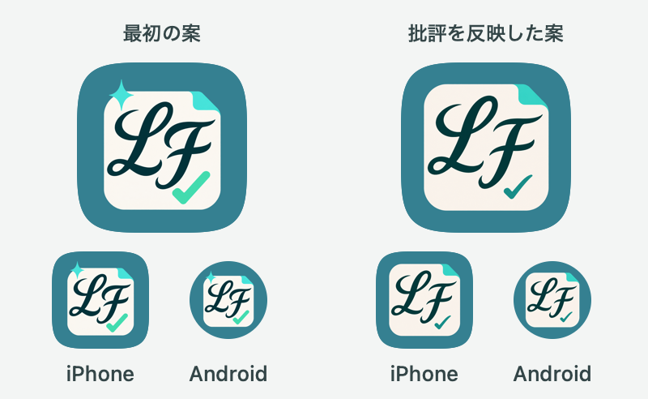

# LiFlowのLFアイコン

利用者が用意した下絵から、筆記体のLの輪、右上を折った紙、完了のチェックを残した。最初の磨き込み案をGPT-6.2 Sol（推論max）に見せ、縮小時の識別性を確認した。右側の採用案は、Fの左への巻き込みを浅くし、Lの払いを短くして二文字の間に紙の色を残した。左上の星を外し、右下のチェックを少し濃い青緑にそろえた。

左は利用者がスクリーンショットで示した最初の磨き込み案、右は採用案。下段はiPhoneの60ptとAndroidの48dpを想定した比較用の描画。アプリ名を隠して初見の利用者に識別してもらう試験は実施していない。



## ビルド資材の確認

- iPhoneのライト・ダークとAndroidの通常アイコンには、青緑の背景まで塗った1024角のPNGを使う。Expo SDK 58が生成したiOSの両画像は元のPNGと全画素が一致し、Xcodeのasset catalogのコンパイルも通過した。
- Androidのアダプティブアイコンは同じ図案の透明な前景と背景色 `#358091` を使う。余白は前景に含めた。生成された5密度で、可視画素の最大半径は31.95〜32.18dp。半径33dpの安全領域に収まった。通常・丸形のリソースをAAPT2でコンパイル・リンクした。
- アイコンと端末テーマの関連テスト8件、lint、型検査が成功した。端末へのインストールとストア配信は今回の確認範囲外。

<details>
<summary>採用案の画像生成指示</summary>

組み込みのImageGenに、星ありの調整案を編集対象として渡した。

```text
One alternate optical proof based on the attached LiFlow monogram, not a new brand. Retain the warm ivory folded note, near-square rounded paper shape, position and size, dark petrol calligraphic LF, diagonally ascending rhythm, generous L ascender loop and little returning lower-left loop. Edit these three details, deliberately visibly, for a 48dp launcher icon. (1) Remove the upper-left sparkle completely, restoring the smooth uninterrupted ivory paper corner. Do not add anything in that space. (2) Make the F naturally clearer: bring the left end of the F's top stroke to near the F's vertical stem, replacing the current deep leftward curl back on itself with a short, shallow curved lead-in. Keep the rightward top swash and the unmistakable separate F middle bar. Slightly shorten the rightward end of the L's baseline flourish; leave a visible channel of cream paper separating the two initials. Maintain contrast and the graceful hand, no generic font. (3) Keep the small right-bottom tick, change its bright grass green to a darker blue-turquoise jade ink, roughly #238E8A, visually in the same family as the fold. Give its tip a softly rounded, mildly tapered end with enough weight to survive reduction. Keep the graphic otherwise very faithful, paper in flat ivory, one flat aqua folded corner, a deliberate compact composition, no external tile. Center the entire emblem on actual transparent alpha with ample margin. No glow, no shadow, no other detail, no added word. Exact two letters: LF.
```

</details>
