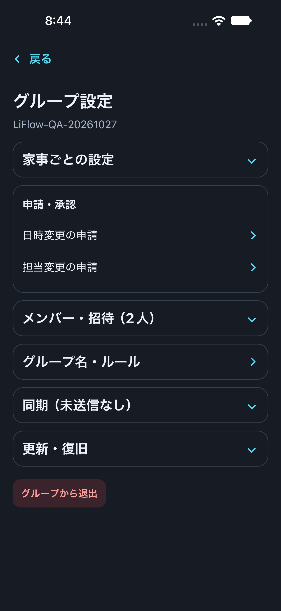
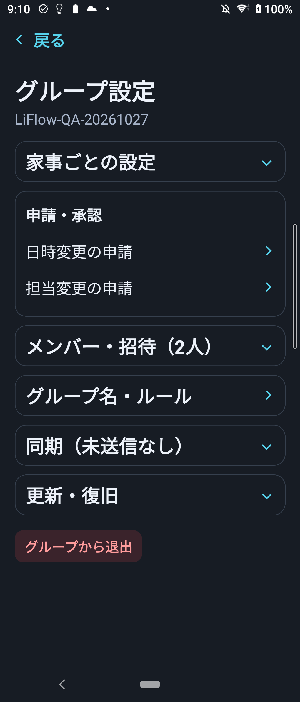

# 全コード監査・不具合修正・最適化記録（2026-11-01）

## 対象と進め方

基準は private `ponkichi1552/LiFlow` の `main`、開始コミットは `62d4f0bbc584c9d2d28448cf592d9fa779d10f1f`。
自前のコード・設定・テスト944ファイル（83,205行、6,354,020バイト）をすべて読了してから、再現テストと修正に着手した。ファイルごとの開始時SHA-256と読了範囲はローカル監査台帳で確認済み。生成物、依存ライブラリ全ソース、秘密設定、個人の検査データを「全コード読了」に含めてはいない。

不具合候補と最適化候補を先に記録し、呼び出し元・保存形式・権限境界を追跡して採否を決めた。今回の検査は開発工程内の検査であり、独立した第三者監査ではない。未知の不具合が存在しないという保証にもならない。

## 修正した不具合と境界

| 対象 | 確認した問題 | 修正・回帰検査 |
| --- | --- | --- |
| グループ設定 | 「グループ名・ルール」だけ別のCard余白が加算される | 折りたたみ見出しと同じ共通スタイルのリンク行に統一。遷移先・権限・項目順は維持 |
| 招待への参加 | 非表示・アカウント変更後に古い参加処理が画面遷移する | 管理画面と招待ルートで、待機後にマウント状態と元アカウントを再確認 |
| 日曜の繰り返し | Plannerの日曜=7とCalendarの日曜=0が混在 | Calendar境界だけで0〜6へ正規化。日曜開始の複数週と毎月第N曜日の初期値を検査 |
| AI解析の結合結果 | 個別には上限内でも、同名作業の結合後に配列上限を超える | 最終結合結果を同じ検証器で再検査。アプリで利用できない結果を成功扱いしない |
| AI解析の保存 | 有料解析が成功しても、一時的な終端保存エラーで結果を失う | 冪等な終端保存だけを最大4回再試行。解析自体は再実行せず、恒久エラー・期限切れは中断 |
| 旧開発用の出典照合 | URLのクエリが違う別資料を同じ資料と扱う | クエリを含めて比較。公開APIの「添付PDFのみ」の方針は維持 |
| Snapshot取得 | 取得元の署名確認より先に多数のデータ片を読む | 呼び出し側の検証済み名簿を必須化。所有者署名を先に確認し、個々のサイズ・ハッシュを照合 |
| Snapshotの選択 | 同じ受付位置の旧鍵Snapshotへ差し戻せる条件が残る | 現在の鍵バージョンとの一致をRulesでも要求 |
| 招待の一覧 | 取消済み招待が100件を超えると、新しい招待を見落とす | 安定したID順で100件ずつ取得。取消済み105件の後の有効な招待で検査 |
| 同期時間 | 表示名の追送信で元の時間枠を数え直す | 残り時間を引き継ぐ。Calendar初期化時間も差し引き、履歴整理は送受信後に残り時間内で実行 |
| 時間切れ後の処理 | SDK待機が終わった後も後続の取得・保存を開始する | Snapshot取得・準備・公開・履歴整理・PDF保持に協調的な期限確認を追加。発行済みSDK通信の取消保証はしない |
| 復旧する履歴量 | 4,096件の汎用配列制限と、大きい復旧履歴の仕様が不整合 | 小さい既存証明は維持。大きい履歴は1,000件ごとの順序付きハッシュで照合。4,104件の永続化・再起動復旧を検査 |
| 完了後の表示 | 古いrefreshが画面へ反映されていないのに成功を返す | 最新モデルを実際に表示した場合だけ成功。保存済み操作を失わず再読込可能にする |
| ゴミ予定の取り消し | 保存済みの復元機能が管理画面から使えない | 控えめな固定位置の「元に戻す」を追加。削除前の非表示日も復元。保存失敗時は再試行可能 |
| ヘルプ・PDF表示 | 保存ボタン、下部の戻る、自動説明書検索など旧仕様の説明が残る | 現行の自動保存・左上の戻る・添付PDF・期間内件数に合わせて修正 |
| 以前の検査データ | 古いグループ記録が複数あり現在位置がないとログイン後の表示が失敗 | 同一アカウントのサーバー所属と既存の端末記録が一致した場合だけ現在位置を復旧。履歴は削除せず、未知・退出済み・通信不能・アカウント変更を拒否 |

## 最適化の採否

| 候補 | 結果 |
| --- | --- |
| 招待申請の逐次取得 | 最大4件の並列取得へ変更 |
| グループ設定の重複読込 | 実行中の読み込みを合流し、その間の変更をまとめて再取得。最初の有効な表示は次の読込完了まで待たせない |
| Snapshotの逐次取得 | 最大4件の並列取得。確認前の並列ダウンロードや無制限並列化は行わない |
| 時間切れ後の後続処理 | 次の取得・保存を止め、確定不明の操作は既存の同一IDによる再送で回復 |
| カードごとの全履歴Map再構築 | 履歴配列の同一性に結び付けたWeakMapを共有。5,000件の履歴・100カードで索引走査は5,000件。権限・表示可否は毎回確認 |
| メンバー名の索引・取り消し対象の検索 | 不変の配列に結び付けた索引を再利用し、対象の履歴に限定 |
| 各家事回の直近完了日の検索・日付変換・並べ替え | 家事・対象者ごとに一度計算して再利用。クールダウン等の意味は維持 |
| Calendarの読込時の初期分類書込 | 欠けた分類だけ補う。変更なしの10回の読み込みで分類書込0件、分類を削除した場合は1件だけ復旧 |
| 最新スキーマへの反復マイグレーション | 実際のバージョンを毎回確認し、最新なら書込トランザクション不要。同じ接続で旧バージョンに戻された場合は再移行 |
| CalendarとPlannerの更新判定 | ローカル予定と有効なGoogle空き時間を同じ方式で合成して署名化。変更なし3回で再計算0回、実際の空き時間変更は1回だけ再計算 |
| Google共有予定追加の私有メタデータ | 接続・送信状態・紐付けの読書きは所属と端末・DBの確認に限定。業務履歴の全再演算を省く。予定内容と通知の共有方針は完全な検証を維持 |
| 家電の個人コピー | 元々「家電ごと」ではなく「変更バッチごと」に接続していた。バッチ化と確実なcloseを維持し、共通の初期化と残り時間を改善 |
| 開発用資料探索コード | 開発用互換経路に呼び出し元があり、importだけで検索・課金は発生しない。機能を消す変更は不採用 |
| 本人端末の権限履歴の省略 | 保存したheadだけでは署名付きの信頼経路を置き換えられないため不採用 |
| Home向けモデルから設定・競合情報を省く | 完了等の操作権限にも利用されるため不採用。安全性を落とす省略をしない |
| PDFキャッシュの追加 | 既に復号・組立キャッシュに各12MiBの上限がある。追加の無制限キャッシュは不採用 |

これらは重複処理回数の削減を確認した結果であり、「起動が1秒未満」「何倍速くなった」という実機計測結果へ読み替えない。

## 開発ツールの依存脆弱性

Expo SDK58の依存範囲を維持し、glob13.0.6とminimatch10.2.6に公式修正の該当箇所をバックポートした。`postinstall`でCJS/ESMの双方へ再適用される。対象コードが変わった場合は黙って適用を飛ばさず、更新の再評価を要求する。

- globのAbortSignal中断後の再帰継続を停止。同期・非同期、CJS・ESMで中断後の追加ファイル読込0件を検査。
- minimatchの特殊パターン展開と二次比較の増大を制限。通常のマッチングと既存ESLintのv3呼び出し形式も保持。
- npm auditはバージョンで判定するため**moderate27経路の警告は残る**。27個の独立したアプリ侵入経路という意味ではない。high/criticalは0、API側のauditは0。

根拠：[globの公式アドバイザリ](https://github.com/advisories/GHSA-3g3m-2fjr-6pw4)、[minimatchの公式修正](https://github.com/isaacs/minimatch/commit/77a0f5c)。

## 誤検出・変更しなかった境界

- Calendarの透過色連結は既に具体的な色へ対応済みだった。
- Googleへ未確定の共有予定を送らない場合、単なる一覧からの欠落ではGoogle予定を削除しない。明示的な確定削除だけを送信する。
- 家電競合の解決は新しい家電操作IDになるため、保持キャッシュの更新対象になる。
- 個人Google Calendarの現在の実装はFreeBusy。共有一般予定のGoogle追加と、個人予定の完全な双方向同期を混同しない。未搭載の個人双方向同期を、この監査で実装・検証済みとは扱わない。
- Gitleaksの現行ソース・記録スキャン20候補は、ソース・検査記録のSHA-256が4件、隔離検査の鍵をSHA-256で比較した値が15件、期限切れの署名なし合成JWTを使うテスト1件。過去の検査コードまで追跡し、比較値は鍵そのものではないことを確認した。

## バージョンと検証

共有計算のソース契約は `liflow-shared-2-draft-44`。以前の対応バージョンは保持し、所有者が署名して更新する経路を維持する。v1の計算契約・既存記録を黙って書き換えない。

- 最初の修正一式：iOS・Android各2,613件PASS。
- 実機で追加発見した旧グループ現在位置の復旧：関連49件PASS。最終のiOS全件2,618件もPASS。公開コミットの両OS検証はGitHub Actionsでも実施する。
- Firestore Emulatorの結合・攻撃検査108件PASS。draft38・43から最新版への所有者署名付き更新も2件PASS（設定・履歴・未送信状態を照合）。
- lint／TypeScript、Expo Doctor20/20、再適用スクリプトを確認。
- Semgrep CEの追加実行は127ルール、約99.9%解析、指摘0。対象はsrc・server・scriptsの認識対象コードであり、生成物や全テストを解析したという意味ではない。confirmation.tsの構文に部分的パースエラー1件があり、TypeScriptと関連動作テストで補完した。静的解析の件数を手動読了や安全性の証明と混同しない。
- 本番Rulesは変更前がレビュー済み基準と一致することを読み取り・保存した後、同じプロジェクトへ修正を反映。公開内容を再取得し、修正済みローカルRulesとの完全一致を確認した。

## 実画面確認

iOSシミュレーターとiPhoneのReleaseで、グループ設定を開く、メンバーの開閉、グループ名・ルールへの遷移を確認した。下の画像は修正後のシミュレーター実表示。追加修正後の最終ReleaseでもiPhone・シミュレーターの検査を再実施してPASS。Android実機でも既存グループを復旧して設定を表示し、折りたたみ行の操作範囲は120〜121px、グループ名・ルールは121pxで揃っていることを確認した。

検査時はアプリの初期化・アンインストールを行っていない。iPhoneの48DB・WALとシミュレーターの6DB・WALは更新前後のハッシュが一致。Androidは同一署名・同一UID・初回インストール日時を確認して上書きし、DB内容の完全ハッシュ照合はしていない。

Androidの旧QA記録では、サーバーの「現在の所属」自体も未登録だった。iPhoneの保存済み・検証済み名簿と同じQAグループに既に承認されているアカウントであることを照合し、トランザクションで不足した現在位置だけを補った。新しいメンバーの承認、鍵の変更、家事・履歴の編集や削除は行っていない。アプリの自動復旧と、開発中の旧QAデータへのこの補完操作は区別する。

検査結果・実機確認・公開Rules照合の要約は [verification.json](qa-assets/full-code-audit-2026-11-01/verification.json) に記録する。失敗を含む詳細ログと読了台帳・元データの保管先はローカルの監査チェックポイントに保持し、Gitへは秘密設定・実機DB・個人の未採用artifactsを含めない。
